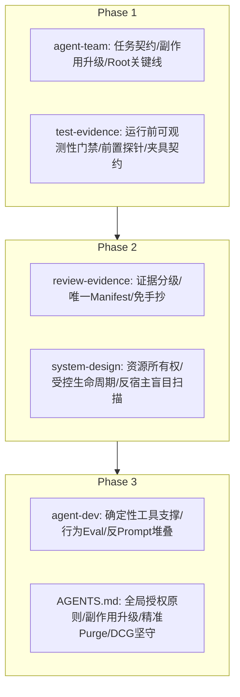

# yuis_skills 技能改进方案（第一版计划）

> **状态**：方案已冻结待评审，不包含对现有 `SKILL.md` / `AGENTS.md` 实现的直接修改，未发布或安装。  
> **指导思想**：结合 `writing-great-skills` 元方法论（可预测性、信息梯子、正面引导、高内聚引导词、消除 No-op、显式完成准则），从跨项目、跨语言、跨运行时的全局视角提炼通用机制，杜绝针对特定项目的临时补丁与脆弱 prompt 堆叠。

---

## 1. 现有规则覆盖、缺失与执行失败归因表

复盘 SoulMate 开发过程中暴露的 10 类典型痛点，将其严格区分为**“已有规则但执行失败（Execution Breakdown）”**、**“规则缺失或表述模糊（Rule Gap / Ambiguity）”**与**“确定性工具/运行时机制缺失（Tooling / Runtime Mechanism Gap）”**，避免盲目添加同义训诫：

| 序号 | 现实痛点 / 故障现象 | 现有规则覆盖情况 | 根本归因分类 | 核心根因与治理策略 |
|---|---|---|---|---|
| **1** | **诊断缺失**<br>原生 stdout/stderr 仅统计字节或被吞没，真实错误永久丢失；误将“删除一切事实”当成隐私保护 | `test-evidence:26` 规定“从最原始的输入（原生堆栈跟踪、运行时日志）进行调查”；`AGENTS.md` 规定保留现场 | **规则缺失 + 工具机制缺失** | 现有规则只说了事后排查用原日志，**缺少运行前可观测性门禁（Failure Observability Gate）**：未在执行前强制要求失败时能捕获原生诊断；需建立经批准的本地受限诊断日志与脱敏公共投影机制。 |
| **2** | **观察模型错误**<br>把瞬时短暂状态用 exactly1 强行阻断；FD 关闭竞态；用外部轮询（poll）试图证明完备后代历史 | `system-design` 定义了运行时与并发边界；`test-evidence` 明确 mock/静态不能替代运行时行为 | **规则缺失（认知模型偏差）** | 规则未明确**资源所有权与隔离生命周期模型**。依赖宿主全局盲目扫描属于反模式；必须强制在测试中声明观测能力的有效边界，优先采用受控隔离环境（如独立容器/独立网络命名空间）而非在共享宿主上打补丁。 |
| **3** | **细粒度逐项审批造成严重串行**<br>函数白名单、局部文件检查点频繁停滞等待 Root 审批 | `AGENTS.md` 规定“在授权范围内完成，既有授权保持有效，不因小决策无谓中断” | **规则表述模糊 + 缺少操作性定义** | 现有“既有授权有效”过于抽象。执行端将函数/内部文件变更等同于越权风险。应确立**“按目标/结果授权，按副作用升级（Outcome Authorization, Side-effect Escalation）”**机制：在已承诺契约内，调用链小修与局部适配自主闭环；仅在外部协议破坏、跨信任域调用、持久化模式破坏、超出授权的不可逆操作时升级。 |
| **4** | **回合超时与硬截止导致资源泄漏**<br>模型上下文回合进入硬截止，超 cleanup 预算，遗留脏目录与孤儿进程 | `test-evidence:33` 提及异步与进程级验证应声明资源生命周期与超时 | **规则缺失 + 运行架构缺陷** | **清理与恢复必须由受监督的底层执行驱动器控制**，绝不能依赖模型回合“下次回来清理”。规则须强制：总执行超时预算必须包含并在内部预留 Cleanup Buffer；驱动器进程负责在单次生命周期内完成清理兜底。 |
| **5** | **重复证据包装与机械手抄**<br>细微修改产出数十个证据文件，多层重复遍历，反复手抄 SHA、计数与退出码 | `review-evidence:10` 明确“常规修改不需要完整证据包”；`:35` 明确“不手动抄录工具可生成的事实”；`:42` 明确“风险抽样非机械全重跑” | **纯执行失败（仪式化过度防卫）** | 现有规则已经非常清楚，但由于缺少结构化约束，执行端极易滑入过度防御。需在 `review-evidence` 中引入**“分级最小证据模型”**与**“唯一机器事实 Manifest”**，规定作者、独审、Root 统一基于该 Manifest 声明结论与锚点，禁止在层级间二次派生并列文件。 |
| **6** | **测试夹具自身反复出错**<br>时钟漂移、类型混杂、AST 字符串拼接、映射异常；夹具自身故障率高于产品代码 | `test-evidence:43` 明确“测试基础设施阻塞产品开发时，必须拆分独立切片” | **规则缺失 + 质量防御缺失** | 测试夹具自身缺乏能力契约（Capability Contract）与合规性自测。规则须规定：**测试夹具必须具备显式能力声明与对真实 OS 的默认拒绝**；若出现连续两次夹具自身报错，必须停止重试，直接升级为基础设施缺陷诊断。 |
| **7** | **状态源失效与事件堆叠**<br>CURRENT 落后、心跳“无变化”重复长报告、DCG 误报拦截后状态处理不当 | `AGENTS.md` 对 DCG 的拦截处理与状态同步 | **规则模糊 + 工具机制缺失** | 缺少最小状态投影与事件去重（Event Deduplication）定义。对于 DCG 拦截：因 DCG 存在大量启发式误报，人工难以逐行确认命令细节，应规范**在确认操作安全受控的前提下，优先拆分为更安全的小命令；若仍被误报阻断，使用 DCG 白名单/allow-once 机制放行**；若涉及越界破坏或真实不可逆风险才升级等待。状态源必须维护单一事实投影，无新事件禁止冗长复读。 |
| **8** | **能力可行性验证过晚**<br>进行多轮深度设计与构建后，才在运行时暴露出底层能力缺失（STOP） | `arch-guard` / `test-evidence` 均强调前置环境边界 | **规则缺失（执行序错误）** | 缺少**前置环境探针（Preflight Probe）**的强制步骤。在开展任何昂贵的代码构建前，必须先以最小副作用探针探测目标环境的核心系统调用/网络/权限边界；不满足则立即阻断并报告依赖，杜绝虚假施工。 |
| **9** | **清理未覆盖净空间释放**<br>仅做逻辑移除或未清空回收站，导致物理磁盘耗尽；频繁重复编写清理框架 | `AGENTS.md` 规定删除用 `trash-cli`，永久删除需明确授权 | **规则不闭环（定义缺失）** | 规则未将“物理净空间释放”作为清理的最终判定条件。需明确：**逻辑删除不等于净释放**；在用户显式授权的临时空间范围内，清理协议必须包含精准的 Trash Purge 闭环，同时严格锁定路径，禁止全局无差别清理。 |
| **10** | **盲目并行与层级授权混乱**<br>堆叠更多 Agent 反而增加协调延迟；Root 沦为纯转发瓶颈；递归授权与层级模糊 | `agent-team:16` 明确“Root 必须承担一条实质关键推进线”；`:38` 明确“完成通知是事件，不代表根目标完成” | **执行失败 + 规则需扩充支持显式层级委派** | 现有规则强制“Only the root agent delegates”，这在扁平小型任务有效，但在复杂大型工程中限制了领队级（Lead）的分域协调。应演进为：**支持显式授权的分层委派（Hierarchical Delegation）**，但严格禁止盲目递归；同时强化 Root 在关键路径上的产出职责，杜绝“纯签收型”瓶颈。 |

---

## 2. 拟改文件清单与边界划分（Skill vs Project Tool）

### 2.1 拟改文件清单（严格中英双语对齐）

按照仓库规范，所有核心技能均在中英两个文件中保持 1:1 结构与语义对齐：
1. **`agent-team/SKILL.md` & `SKILL.zh-CN.md`**：任务契约模型、副作用升级边界、Root 关键路径职责、分层委派授权、事件去重。
2. **`test-evidence/SKILL.md` & `test-evidence/SKILL.zh-CN.md`**：运行前可观测性门禁、前置探针（Preflight Probe）、夹具能力契约与连续故障熔断、净空间释放标准。
3. **`review-evidence/SKILL.md` & `review-evidence/SKILL.zh-CN.md`**：证据三级分级、唯一机器事实清单（Machine-generated Manifest）、免手抄机制、风险抽样深度。
4. **`system-design/SKILL.md` & `SKILL.zh-CN.md`**：进程与资源所有权、受控隔离生命周期 vs 宿主盲目扫描、威胁模型与并发安全边界。
5. **`agent-dev/SKILL.md` & `SKILL.zh-CN.md`**：状态与日志由确定性工具保障、行为 Eval 基准与成本/回归对比、杜绝纯 Prompt 堆叠。
6. **`AGENTS.md` & `AGENTS.zh-CN.md`**：全局契约同步：既有授权持续有效原则、按副作用升级、授权内精确 Trash 释放、DCG 拒绝不可绕过。

### 2.2 明确边界：通用技能与项目工具的职责隔离

严防把具体的项目逻辑泛化为通用技能，技能库只承载**方法论、契约规范与决策阶梯**：

| 维度 | 通用技能层（`yuis_skills`）承担 | 项目本地工程工具（Project Tools）承担 |
|---|---|---|
| **状态与编排** | 定义 `Task Contract` 必备字段（目标结果、允许副作用、升级条件、验收标准）；定义事件去重与单一事实原则。 | 具体的 Paseo / Tmux / SQLite 状态管理器脚本、特定轮询逻辑与消息队列。 |
| **可观测性** | 规定运行前必须具备原生 stdout/stderr 捕获通道；规定脱敏公共投影与受限原日志的治理原则。 | 具体的日志采集器、正则脱敏器、特定框架的 Trace 抓取脚本。 |
| **测试与探针** | 规范前置探针的执行序（Preflight-first）；规范夹具失败的架构熔断阈值；禁止用 mock 冒充真实集成。 | 具体的 Linux Syscall 探针、Docker 容器隔离脚本、特定的 Flutter/Go/Python 测试套件。 |
| **存储与清理** | 定义“物理净空间释放”验收准则；定义指定目录精确 Purge 的授权要求；禁止全盘盲目删除。 | 具体的 `trash-cli` 包装脚本、BTRFS 快照脚本、磁盘空间监控脚本。 |

---

## 3. 核心机制设计与拟议措辞（含正面引导与例外）

遵循 `writing-great-skills` 原则：**消除“粉色大象”（将“禁止做某事”重构为“执行正确行为”并配对兜底），提炼高内聚引导词（Leading Words），确立 checkable & exhaustive 的完成准则。**

### 3.1 机制 A：任务契约与副作用升级（Task Contract & Side-effect Escalation）
*应用位置：`agent-team`*

- **核心概念（Leading Words）**：`Task Contract`, `Side-effect Escalation`, `Autonomous Closure`
- **拟议正向规则**：
  > 委派任务必须绑定明确的 **Task Contract**，包含：目标业务结果（Target Outcome）、允许的读写与执行边界（Permitted Boundary）、可观测交付物（Deliverable）、升级阈值（Escalation Triggers）。  
  > **在契约所界定的边界内，执行者享有自治闭环权（Autonomous Closure）**：对于接口内部实现适配、私有调用链补齐、局部编译/单测修复，执行者应自主推进至完成，无需反复向上级暂停索要白名单确认。  
  > **仅在触碰以下关键副作用时触发升级（Side-effect Escalation）**：
  > 1. 产生超出任务范围的公有外部协议或跨组件 API 变更；
  > 2. 引入未授权的外部网络通信、跨信任域凭证访问或特权操作；
  > 3. 引入不可逆的持久化结构变动、数据丢弃或破坏性文件覆盖；
  > 4. 出现工具执行拒绝（如 DCG 拦截、权限阻断）：首先确认操作是否安全且在授权范围内；在确认安全的前提下，优先将命令拆分成更小、更针对性的局部子命令；若仍因误报被阻断，可通过 DCG 白名单或 allow-once 机制放行；若判定存在超出授权的越界破坏风险，则必须停止并向 Root 报告。
- **不适用与例外**：
  - 探索性调研（Research）、一次性抛弃型原型（Prototype）不强制要求完整形式化契约。
  - 用户实时直接交互会话不受此契约形式限制。

### 3.2 机制 B：运行前可观测性门禁（Failure Observability Gate）
*应用位置：`test-evidence`*

- **核心概念（Leading Words）**：`Failure Observability`, `Preflight Probe`, `Sanitized Projection`
- **拟议正向规则**：
  > **在执行任何真实测试、构建或探针前，先确立故障可解释性（Failure Observability Gate）**：
  > 1. 执行驱动器必须确保在目标失败时，能够直接捕获并持久化原生的标准输出（stdout）、标准错误（stderr）、退出码（exit code）及崩溃堆栈。
  > 2. 捕获通道必须独立于被测进程本身；严禁使用仅统计传输字节数而丢弃文本内容的管道封装。
  > 3. 兼顾隐私保护与可调试性：将敏感凭证过滤后形成可在审查流中公开的脱敏投影（Sanitized Projection），同时将完整的可诊断原始日志安全保留在受限的本地临时路径中，供深度回溯。
  > 4. **前置探针优先（Preflight Probe First）**：进入实质开发或大型测试前，必须运行最小副作用环境探针验证底层系统调用与依赖就绪；若探针报告能力缺失，立即将该环境依赖显式冻结为阻塞项，严禁通过编写大量空转测试来掩盖环境缺陷。
- **不适用与例外**：
  - 纯内存运行的确定性单元算法测试（如数学纯函数）可直接运行，无需复杂系统级探针。

### 3.3 机制 C：分级最小证据模型与事实清单（Tiered Evidence & Manifest）
*应用位置：`review-evidence`*

- **核心概念（Leading Words）**：`Evidence Manifest`, `Tiered Evidence`, `Single Anchor`
- **拟议正向规则**：
  > 证据包遵循**按风险分级（Tiered Evidence）**原则，拒绝为常规改动堆砌形式化报告：
  > 1. **机械事实清单（Evidence Manifest）**：由自动化工具或单一权威脚本生成统一的 JSON/Markdown 摘要（包含 Commit SHA、构建退出码、通过/失败用例清单、覆盖率原始数据）。该清单为机器事实的唯一真相源（Single Source of Truth）。
  > 2. **结论引用（Single Anchor Reference）**：代码作者（Author）、独立评审员（Reviewer）与总协调者（Root）在出具意见时，直接引用该 Manifest 中的锚点条目或哈希，严禁在多级交付物之间反复人工抄写 SHA、用例数和退出状态。
  > 3. **证据分级**：
  >    - *轻量级（Tier-1，常规小修）*：代码 Diff + 关键测试单次通过退出码；
  >    - *行为级（Tier-2，特性与重构）*：Manifest + 关键行为测试断言 + 逆向反例；
  >    - *严格级（Tier-3，涉及安全/数据/跨系统边界）*：完整独立评审上下文、风险抽样验证记录、不可逆变更证据。
- **不适用与例外**：
  - 文档、注释、非代码配置微调仅需 Tier-1 静态检查结果，免除形式化证据包。

### 3.4 机制 D：受监督生命周期与净空间释放（Supervised Lifecycle & Net Space Release）
*应用位置：`system-design`, `test-evidence`, `AGENTS.md`*

- **核心概念（Leading Words）**：`Supervised Lifecycle`, `Net Space Release`, `Precise Purge`
- **拟议正向规则**：
  > 跨进程与系统级资源的测试，必须由具备完整生命周期控制能力的受监督驱动器统筹管理：
  > 1. **预算与清理缓冲（Cleanup Buffer）**：在为长耗时测试或批处理任务设定总时间预算时，驱动器内部必须预留至少 15%~20% 的时间作为强制收尾缓冲。当执行超时触发时，驱动器保证在主流程退出前完成子进程终止与文件句柄释放。
  > 2. **净空间释放验收（Net Space Release）**：清理工作的完成标准不是“执行了删除命令”，而是“物理磁盘可用空间真实回升且未留无主孤儿对象”。
  > 3. **精准清理闭环（Precise Purge）**：在用户明确授权的废弃候选目录（如特定测试输出目录）范围内，清理流程必须完成从逻辑废弃到指定 Trash 目录精准 Purge 的完整闭环；严禁进行全盘无范围约束的永久清理。

### 3.5 机制 E：工作树租约与短命会话回收（Worktree Lease & Ephemeral Reclamation）
*应用位置：`agent-team`, `AGENTS.md`*

- **核心概念（Leading Words）**：`Worktree Lease`, `Stateless Worker`, `Orchestrator Digest Isolation`
- **拟议正向规则**：
  > 并行开发中的工作树与子会话均作为受限的临时租约（Ephemeral Lease）管理：
  > 1. **短命无状态 Worker（Stateless Worker）**：对原子任务契约优先使用短命、无状态的 Worker 会话，避免长时间跨任务的连续会话积累过长上下文引发推理降智与记忆混淆；任务验收集成后，立即销毁/回收该 Worker 会话。
  > 2. **工作树即用即收（Worktree Reclamation）**：任务合并或废弃后，必须显式移除对应工作树（`git worktree remove`），释放分支锁定、Git 元数据和磁盘空间；派发新任务前强制扫描并清理孤儿工作树，彻底根除“维护几十个工作树不治理”的蔓延乱象。
  > 3. **总控上下文摘要隔离（Orchestrator Digest Isolation）**：严禁将子 Agent 冗长的多轮推演思考链、海量控制台日志直接转发进总控上下文；总控仅读取子任务交付的结构化交接单（包含改动文件、测试命令、退出码、diff 摘要）与 `git diff --stat`。

### 3.6 机制 F：契约先行锁与防接口漂移（Contract-First Lock）
*应用位置：`system-design`, `AGENTS.md`*

- **核心概念（Leading Words）**：`Contract-First Lock`, `Schema Authority`
- **拟议正向规则**：
  > 跨端或跨子系统（后端/Web/移动端）并行实现前，必须先确立架构级契约锁定：
  > 1. 将公共 API Schema、数据传输结构与协议定义作为唯一事实源，统一维护在专有的契约目录（如 `/contracts`、OpenAPI、Protobuf）中；
  > 2. 仅架构设计阶段或指定的契约 Owner 有权修改公有契约；各端叶子 Worker 基于冻结的 Schema、生成的强类型客户端或 Mock 服务独立并行开发，严禁在实现中单方面私自篡改公共接口。

### 3.7 机制 G：防阻塞命令行禁令（Anti-Blocking Command Discipline）
*应用位置：`test-evidence`, `AGENTS.md`*

- **核心概念（Leading Words）**：`Anti-Blocking`, `Non-Interactive Execution`
- **拟议正向规则**：
  > 所有自动化测试与构建命令必须以非交互方式并在显式超时内运行：
  > 1. 强制设定非交互环境变量与标志（如设置 `CI=true`，显式追加 `--watch=false`、`--watchAll=false`），杜绝终端因监听模式或 `y/n` 交互提示而无声假死挂起；
  > 2. 严禁无守护管理直接启动不退出的后台服务；
  > 3. 验证执行范围本地化优先：微小修改仅运行受影响切片或模块的针对性测试，避免无节制触发全量构建。

### 3.8 机制 H：不可变测试守卫与防作弊机制（Immutable Test Guard & Anti-Reward-Hacking）
*应用位置：`test-evidence`, `review-evidence`, `AGENTS.md`*

- **核心概念（Leading Words）**：`Immutable Test Guard`, `Reward-Hacking Defense`, `Forensic Test Audit`
- **拟议正向规则**：
  > 严格杜绝 Agent 在复杂工程中为求“跑绿测试”而实施的形式化作弊（Reward Hacking）：
  > 1. **测试套件不可变性**：在功能实现或缺陷修复阶段，目标测试用例与断言目标必须被视为不可变基准（Immutable Evaluation Baseline），仅当生产代码真正满足锁定测试时交付才算成立；
  > 2. **三类作弊行为硬性阻断**：严禁放宽断言期望值（Assertion Weakening）、注入跳过装饰器（`skip` / `only` 标记）、或者在生产代码中通过打桩硬编码特定输入输出映射表；
  > 3. **复审取证审计（Forensic Test Audit）**：独立复审阶段必须显式比对 `tests/` 目录的 Diff；对测试用例本身的任何修改必须被作为高风险的契约变更单独审计，严禁夹带在常规修复中通过。

---

## 4. 最小变更实施顺序（三阶段推进）

按依赖关系与风险扩散半径分步落地，确保每个阶段均可通过结构检查与语义审查：



### Phase 1：关键执行瓶颈与诊断缺失修复（优先落地）
- **目标**：解决“审批过多导致严重串行”、“失败后无法排查导致无序盲目重试”。
- **涉及文件**：
  - `agent-team/SKILL.md` 与 `agent-team/SKILL.zh-CN.md`
  - `test-evidence/SKILL.md` 与 `test-evidence/SKILL.zh-CN.md`
- **验证门禁**：通过 `check_bilingual_docs.py`，并用案例 1、案例 3 验证模型行为。

### Phase 2：证据内耗消除与观察模型纠偏
- **目标**：解决“重复制造几十个证据文件耗尽上下文”、“在共享宿主上打洞进行脆弱观测”。
- **涉及文件**：
  - `review-evidence/SKILL.md` 与 `review-evidence/SKILL.zh-CN.md`
  - `system-design/SKILL.md` 与 `system-design/SKILL.zh-CN.md`
- **验证门禁**：结构检查通过，用案例 2、案例 5 验证交付精简度与资源隔离有效性。

### Phase 3：开发工具化演进与全局契约闭环
- **目标**：解决“用脆弱 prompt 替代基础设施工具”、“全局授权与安全清理原则断层”。
- **涉及文件**：
  - `agent-dev/SKILL.md` 与 `agent-dev/SKILL.zh-CN.md`
  - `AGENTS.md` 与 `AGENTS.zh-CN.md`
- **验证门禁**：运行完整测试套件，用案例 4、案例 6 验证破坏性安全红线与自动化闭环。

---

## 5. 负面代价与风险权衡（Trade-offs & Defensive Guardrails）

引入新机制必须预判潜在负面副作用，并预设防范策略：

| 机制创新 | 潜在负面代价 / 风险 | 防御与纠偏措施（Guardrails） |
|---|---|---|
| **共享测试工具与统一驱动器** | **共因失效风险（Common-cause Failure）**<br>若测试运行器自身隐藏 bug，将导致上层所有测试全盘瘫痪或得出伪阳性结论。 | 1. 驱动器必须做极简设计，严禁在通用技能库中内置复杂大框架；<br>2. 驱动器自身必须包含能力自测用例；<br>3. 始终保留底层原生运行方式（如直接执行 pytest / go test）作为不可剥夺的兜底对比手段。 |
| **精简证据与机器 Manifest** | **过度压缩风险（Over-compression）**<br>若事实清单过度浓缩，可能掩盖高危系统的细微副作用（如边缘条件竞态、内存微泄漏）。 | 1. 严格落实证据分级：高风险核心业务（数据变更、鉴权、外部通信）依然强制执行 Tier-3 独立评审与深度抽样；<br>2. Manifest 必须保留原始数据输出的路径指针，支持一键深入原始堆栈。 |
| **“按结果授权，按副作用升级”** | **授权过宽风险（Over-authorization / Blast Radius）**<br>执行端可能误解“自治闭环”，将私有适配擅自放大为公有接口破坏或大范围重写。 | 1. 明确正面闭环的范围仅限于契约承诺的目标实现；<br>2. 详尽列举 4 大“必须升级的副作用红线”（协议变更、未授权网络/权限、持久化破坏、DCG 拒绝），触碰即必须向 Root 升级。 |
| **自动化精准清理（Precise Purge）与 DCG 防护** | **误删风险与 DCG 误报卡滞**<br>自动清理若路径错误会误删未提交工作；而 DCG 误报过多又会导致自动化流程频繁假死卡滞。 | 1. 严禁任何全局性的无目录约束 Purge，仅允许在显式授权的临时工作树下执行精准 Purge；<br>2. 针对 DCG 误报，在确认安全且处于受限临时目录的前提下，允许分解为小命令或使用 DCG 白名单/allow-once 绕过；<br>3. 若涉及真正超出授权范围的危险删除，坚决阻断并向人类报告。 |
| **原生日志持久化捕获** | **敏感凭证泄漏风险（Information Leakage）**<br>未加节制地持久化原生输出，可能导致 API Token、私钥或用户数据被写入日志。 | 1. 确立“脱敏公共投影”与“本地受限原日志”的分层隔离；<br>2. 原生日志仅保存在操作系统受限临时目录（`/tmp/private-...` 或受限隔离空间），绝不纳入版本库或公开回复中。 |

---

## 6. 具象行为验收案例（Behavioral Acceptance Test Cases）

每个用例模拟一次典型长程复杂开发场景，评估 Agent 在改版技能引导下的行为跃迁：

### 案例 1：授权范围内小修不无谓挂起
- **场景**：Agent 被委派实现一个内部适配器。开发中发现需要调整下游一个非公开辅助函数的参数签名，并补全两个单元测试。
- **改前行为**：停下所有操作，向 Root 提交审批申请白名单扩展，导致全链路串行等待数十分钟。
- **改后预期行为**：Agent 校验该改动仍在 Task Contract 内部实现范围内，未产生外部协议破坏与外部副作用，自主完成参数调整与单元测试闭环，随同最终成果一次性交付。

### 案例 2：重复通知与无变化心跳幂等吸收
- **场景**：两个子 Agent 并行工作，在 5 分钟内分别返回阶段性“检查无异常”通知，且中间心跳状态无任何变更。
- **改前行为**：Root 每次接收通知均生成长达数页的进展复读报告，甚至因此向用户重新分发完全重复的子任务。
- **改后预期行为**：Root 依据唯一事件 ID 与状态投影执行去重，静默合并无实质变化的事件，仅在达成里程碑或遭遇阻塞时向用户或审查流发出简明汇报。

### 案例 3：故障场景具备直接可诊断性
- **场景**：执行一次跨进程网络通信测试，测试异常退出。
- **改前行为**：日志被通用管道吞没，最终只报告 `Process exited with code 1, 0 bytes captured`，后续花费多轮对话盲猜根因。
- **改后预期行为**：Preflight 门禁确保原生 stderr 被重定向至本地受限日志，报告中直接呈现脱敏后的致命堆栈（如 `BindException: Address already in use`），精准定位于端口冲突。

### 案例 4：总超时预算包含 Cleanup 缓冲
- **场景**：长耗时压力测试被设定了 180 秒执行上限。
- **改前行为**：测试运行到第 179 秒被外部模型或超时硬切断，测试生成的子进程沦为僵尸进程，临时测试数据库未销毁。
- **改后预期行为**：监督驱动器在第 150 秒判定无法收敛，提前触发收尾序列，利用剩余 30 秒安全停止子进程、断开连接并清理临时目录，达成干净退出。

### 案例 5：细微改动杜绝仪式化过度包装
- **场景**：修复一个已定位的空指针 Bug，仅修改 3 行代码并新增 1 个针对性测试。
- **改前行为**：产出作者报告、独立审查报告、新旧对比报告等 20+ 个辅助 Markdown 文件，反复手抄 Git SHA 与测试退出码。
- **改后预期行为**：直接产出代码 Diff 与指向单一测试 Manifest 的引用锚点，以 Tier-1/Tier-2 轻量级证据闭环，上下文保持高度清爽。

### 案例 6：安全底线与 DCG 误报解阻
- **场景**：执行测试清理或局部构建重置时，清理临时目录或子模块构建产物的命令被 DCG 误报拦截。
- **改前行为**：要么盲目死循环重试直到配额耗尽，要么直接停下一切工作等待人工逐行确认命令细节。
- **改后预期行为**：Agent 深入确认该操作确属授权目录内的安全操作后，先拆分为精确的小命令执行；若仍被误报阻断，使用 DCG 白名单/allow-once 合理放行；若确认存在真实越权破坏风险（如涉及父级目录或未暂存用户代码），则保持现场并升级报告。

---

## 7. 评估指标建议（拒绝虚构，关注可验收事实）

禁止捏造“Token 消耗降低 35%”或“效率提升 50%”等无基线佐证的虚假指标。建议以如下**可客观统计的工程交付事实**作为检验依据：

1. **真实端到端业务增量（Verifiable Business Increments）**：
   - 真正通过全链路真实协议与环境检验的特性数量（而非仅通过 mock 的单元测试数或 RAM 记录数）。
2. **端到端交付提前期（Lead Time to Working Delivery）**：
   - 从任务正式分发到获得可工作成果的实际经历墙钟时长（Wall-clock Time）。
3. **Root 无效等待与空转占比（Root Stall Ratio）**：
   - Root 处于“等待低风险白名单审批”、“重复签收无实质变更通知”的时长在总工作时长中的占比（预期大幅下降）。
4. **测试夹具自身故障率（Test Infrastructure Defect Rate）**：
   - 失败总次数中，因“测试夹具自身缺陷（如时钟/类型/路径拼写）”导致的失败占比（应受架构熔断约束迅速压降）。
5. **机器事实重复抄录度（Duplicated Fact Ratio）**：
   - 同一个 Git Commit SHA 或构建 Exit Code 在单次任务交付物体系中出现的重复字数占比（通过 Manifest 机制压至最低）。
6. **不可诊断故障发生次数（Undiagnosable Failure Count）**：
   - 任务失败后因日志丢失而无法还原根因的发生次数（硬性目标为 0）。
7. **遗留清理负债与净空间释放量（Cleanup Debt & Net Space Delta）**：
   - 任务结束后残留的无主孤儿进程数与脏临时目录数（硬性目标为 0）；清理任务执行后的物理磁盘真实净释放容量。

---

## 8. 双语工程与语义验收保证（Bilingual & Semantic Quality）

1. **同等权威双语维护**：
   - 每次修订必须在同一变更集内更新英文原件（`SKILL.md`, `AGENTS.md`）与中文镜像（`SKILL.zh-CN.md`, `AGENTS.zh-CN.md`）。
   - 两者保持相同的规范效力（Obligation Strength），不得存在一语从属、机器直译腔或语义降级。
2. **自动化结构校验**：
   - 实施前与实施后，必须运行并通过：
     ```bash
     python3 scripts/checks/check_bilingual_docs.py
     python3 -m unittest tests/test_bilingual_docs.py
     ```
   - 校验确保：标题层级结构（Heading Levels）、列表标记形状（List Markers）、代码块类型与脚本内容（Code Fences & Blocks）、受保护标记（Protected Inline Tokens / URLs / Paths）绝对对齐。
3. **人工/语义双重视角验收**：
   - 结构脚本不校验自然语言翻译质量。每次变更必须经由具备双语工程能力的高级模型或人类专家进行语义对审，重点审查：
     - 正面引导词翻译的一致性（如 `Task Contract` -> `任务契约`, `Manifest` -> `事实清单`, `Preflight Probe` -> `前置探针`）；
     - 避免在中文版中引入多余的否定式训诫或模糊副词；
     - 确保技术术语在跨语种场景下具备清晰的语义指向。

---

## 9. 结论与下一步

本方案已将实战复盘中的教训完成了跨项目、跨运行时的机制化抽象，明确了从 `agent-team` 到 `AGENTS.md` 的分阶段演进路径。

**当前工作区保持完全纯净，未修改任何通用技能实现文件，未触发发布与安装。** 用户可直接审阅本方案，并在后续对话中指定优先实施的模块或提出微调要求。
